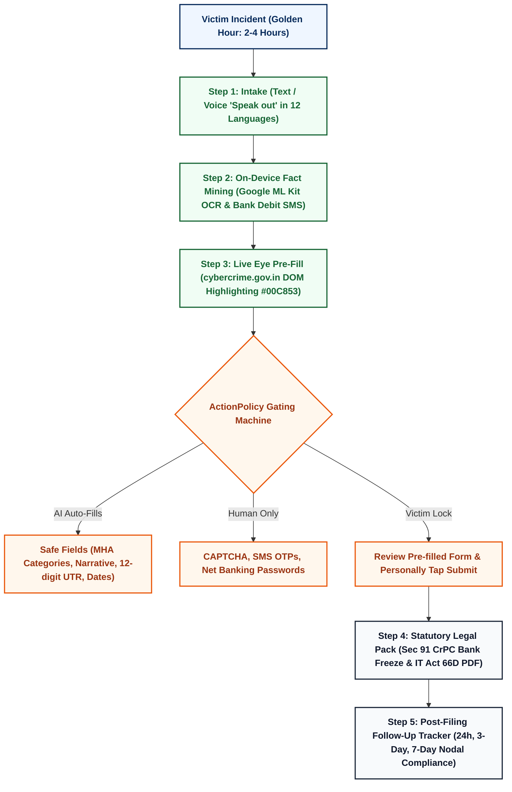
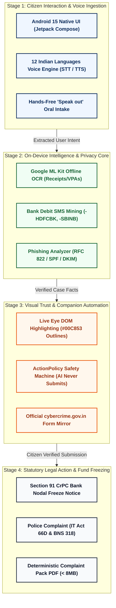

# Cybridge — Cyber Victim Assistant

> **An on-device, privacy-first Android co-pilot empowering Indian citizens during the critical "Golden Hour" of cyber financial fraud.**  
> *Package: `com.cybervictim.assistant` | Target SDK: 35 (Android 15) | Min SDK: 26 (Android 8.0+)*  
> *Built for Bharat Hackathon 5.0 (Unstop) | Track: Cybersecurity & Citizen Empowerment*

[](https://cybridge.vijjadapremsaiofficial.workers.dev/)
[-3DDC84?style=for-the-badge&logo=android)](https://github.com/vijjada/cyber-victim-assistant)
[](https://github.com/vijjada/cyber-victim-assistant)
[-16A34A?style=for-the-badge)](https://github.com/vijjada/cyber-victim-assistant)
[](https://cybridge.vijjadapremsaiofficial.workers.dev/#languages)

---

## 🌐 Live Deployment & Resources

- **Official Live Website & APK Distribution**: **[cybridge.vijjadapremsaiofficial.workers.dev](https://cybridge.vijjadapremsaiofficial.workers.dev/)**
- **GitHub Repository**: **[github.com/vijjada/cyber-victim-assistant](https://github.com/vijjada/cyber-victim-assistant)**
- **Master Technical Specification**: [`CYBRIDGE_MASTER_HANDOVER_DOCUMENTATION.md`](CYBRIDGE_MASTER_HANDOVER_DOCUMENTATION.md)
- **Official Pitch Deck (Bharat 5.0)**: [`bharat-hackathon/Cybridge_BuildWithBharat5.0.pptx`](bharat-hackathon/Cybridge_BuildWithBharat5.0.pptx)
- **National Cybercrime Helpline**: Dial **1930** | Official Portal: **[cybercrime.gov.in](https://cybercrime.gov.in)**

---

## 🚨 The Problem: The Broken Golden Hour

Under the **Ministry of Home Affairs (MHA)** and **Indian Cyber Crime Coordination Centre (I4C)** framework, defrauded funds move through 4 to 6 mule bank accounts within minutes. Victims have a critical **"Golden Hour"** (the first 2 to 4 hours post-incident) to freeze funds under the **1930 Citizen Financial Cyber Fraud Reporting and Management System (CFCFRMS)**.

However, non-technical victims face debilitating friction:
1. **Panic & Lack of Technical Data**: Victims don't know required identifiers (12-digit UTR/RRN numbers, beneficiary UPI VPAs, IFSC, debit timestamps).
2. **Confusing Portal Taxonomy**: The official `cybercrime.gov.in` portal has multi-level nested categories. Selecting the wrong subcategory delays police lien-marking.
3. **Accidental Evidence Deletion**: Distressed citizens often delete transaction receipts, SMS alerts, and suspect chat threads.
4. **45-60 Minute Manual Delays**: Filing manually takes 45 to 60+ minutes, causing the victim to miss the freeze window entirely.

**Cybridge compresses this ordeal into a guided, deterministic < 5-minute action directly from a smartphone.**

---

## 🔄 End-to-End Victim Workflow



---

## 🏛️ System Architecture Pipeline

Cybridge operates on a clean, modular, on-device architecture. Sensitive citizen data stays on the local smartphone, while cloud dependencies are strictly opt-in:



---

## 🛡️ "You Stay in Control": The ActionPolicy Safety Invariant

To guarantee absolute citizen safety and ethical AI operation, Cybridge enforces strict programmatic gating (`StepOwner`) across all official portal interactions:


> **Core Safety Invariant**: Cybridge will **never** submit a government report on your behalf, will **never** attempt to bypass CAPTCHA, and will **never** inspect or store bank passwords or SMS OTPs.

---

## ✨ Core Built Capabilities

| Module | Technical Implementation | Value to Cybercrime Victim |
|---|---|---|
| **Exact MHA Category Mapping** | Deterministic category decision tree (`scenario_buttons.json`) | Eliminates police rejection and re-routing delays (100% 40/40 benchmark accuracy). |
| **Skyvern-Style "Live Portal Eye"** | JavaScript DOM injection with CSS `#00C853` green outlines & audit logs | Eliminates fear of "black box" automation by showing real-time on-screen actions. |
| **On-Device OCR Evidence Vault** | Offline Google ML Kit Text Recognition with subsampled bitmaps | Extracts 12-digit UTRs and UPI VPAs from payment screenshots without cloud uploads. |
| **Bank Debit SMS Mining** | Automated regex tokenizer scanning `-HDFCBK`, `-SBINB`, `-ICICIB` | Automatically pulls verified transaction references from official bank alert SMS. |
| **Suspicious Email Analyzer** | Pure RFC 822 / RFC 2047 MIME parser, SPF/DKIM/DMARC evaluator | Detects lookalike banking domains and credential harvesting phishing attempts. |
| **Statutory Legal Drafter** | Legal synthesis citing Sec 66D IT Act & Sec 318(4) Bharatiya Nyaya Sanhita (BNS) | Produces police-grade complaints and formal Section 91 CrPC Bank Freeze notices. |
| **Complaint PDF Pack** | Native Android `PdfDocument` with recursive size budgeting | Compiles complaint facts and screenshots into a single PDF guaranteed under 8 MB. |
| **12 Indian Languages Voice Guide** | Native Android `SpeechRecognizer` (STT) + `TextToSpeech` (TTS) | Empowers non-English speaking citizens in Hindi, Telugu, Tamil, Bengali, Marathi, etc. |
| **Phone Trace Remote Audit** | Android Package Manager permission analyzer | Flags suspicious remote control apps (AnyDesk, TeamViewer, RustDesk) installed by scammers. |

---

## 🧪 Testing Verification & Accuracy Gates

The codebase contains exhaustive deterministic test suites in `app/src/test/java`:

- **`PlanAccuracyTest`**: **40/40 (100% Pass Rate)** validating deterministic MHA category routing across real-world Indian cyber fraud scenarios.
- **`PhishingAnalyzerTest`**: **4/4 (100% Pass Rate)** validating SPF/DKIM/DMARC failure detection and lookalike banking domains.
- **Physical Device Validation**: Built, installed, and validated on **Xiaomi Redmi 13 5G (`2406ERN9CI`) running Android 15 (Target SDK 35)**.

---

## 🚀 Quickstart & Build Runbook

```bash
# 1. Clone repository
git clone https://github.com/vijjada/cyber-victim-assistant.git
cd cyber-victim-assistant

# 2. Run unit test suites
./gradlew testDebugUnitTest

# 3. Build debug APK
./gradlew assembleDebug

# 4. Install onto connected Android device
adb install -r -d -t app/build/outputs/apk/debug/app-debug.apk
adb shell am start -n com.cybervictim.assistant/.MainActivity

# 5. Run local microservices (Optional)
cd tools/backend
npm install
PORT=8081 node server.js
```

---

## 👨‍💻 Project Team

- **Lead Engineer & System Architect**: **Vijjada Prem Sai**  
  *B.Tech - CSE (Cybersecurity) | GD Goenka University, Gurugram*  
  *Email: vijjadapremsaiofficial@gmail.com | Phone: +91 7416002834*  
- **Event**: Bharat Hackathon 5.0 (Submission via Unstop)

---

## ⚖️ Mandatory Statutory Disclaimer

*Cybridge is an independent assistance tool and is not affiliated with or endorsed by the Government of India, I4C, or the Ministry of Home Affairs. It helps citizens prepare information; complaints must be submitted directly on the official portal ([cybercrime.gov.in](https://cybercrime.gov.in)) or by calling **1930**. This is not legal advice.*
